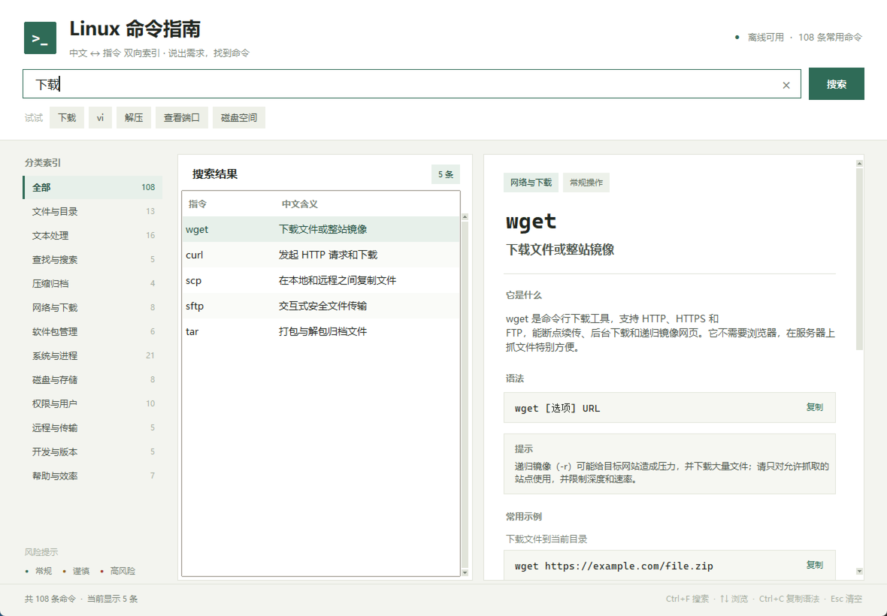
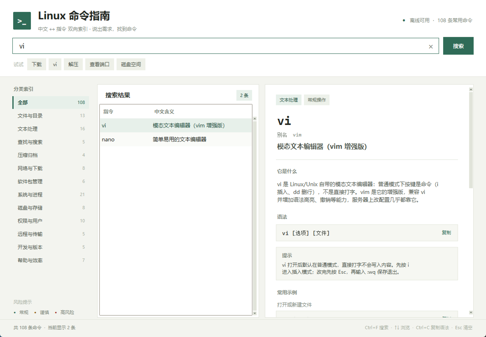

# Linux 命令指南

一个简约的 Linux 桌面命令速查工具：**中文需求 ↔ 指令双向索引**。  
输入「下载」「查看端口」「改权限」，它会告诉你该用什么命令；输入「vi」「tar」，它会解释这是什么、怎么用、有什么风险。





## 它能做什么

- **中文 → 指令**：按用途搜索，例如「下载」「解压」「找文件」「查端口」。
- **指令 → 中文**：输入命令名或别名，例如 `vi`、`vim`、`apt-get`，直接看它是什么。
- **一条命令讲清楚**：中文说明、完整语法、常用示例、常用参数、注意事项。
- **风险分级**：常规操作 / 需谨慎 / 高风险，`rm`、`dd`、`mkfs`、`fdisk` 等会明确提醒。
- **分类浏览**：文件、文本、搜索、压缩、网络、软件包、系统、磁盘、权限、远程、开发、帮助，共 12 类。
- **完全离线**：数据内置，不联网、不上传任何搜索词。
- **一键复制**：语法和示例都可点击「复制」；键盘 `Ctrl+C` 也能复制当前命令语法。

目前已收录 **108 条常用命令**，词条以紧凑的中文速查为目标，不替代 `man` 的完整说明。

## 在 Linux 上运行

需要 Python 3.9+ 和 Tk 图形库（大多数桌面发行版已自带）。

### Debian / Ubuntu

```bash
sudo apt update
sudo apt install python3 python3-tk fonts-noto-cjk
cd linux-command-guide
bash run.sh
```

### Fedora / RHEL

```bash
sudo dnf install python3 python3-tkinter google-noto-sans-cjk-fonts
bash run.sh
```

### Arch Linux

```bash
sudo pacman -S python tk noto-fonts-cjk
bash run.sh
```

也可以直接：

```bash
python3 app.py
```

> 教程统一用 `bash run.sh` 调用，脚本无需预先添加执行权限。  
> 如果报错 `No module named tkinter`，安装上面的 `python3-tk` / `python3-tkinter` / `tk` 包即可。  
> 如果中文显示成方块，安装 Noto CJK 字体后重新打开程序。

## 安装到应用菜单

```bash
bash install.sh
```

安装脚本会把程序复制到 `~/.local/share/linux-command-guide`，并创建：

- 应用菜单项：**Linux 命令指南**
- 终端启动器：`~/.local/bin/linux-command-guide`

卸载：

```bash
bash install.sh --uninstall
```

## 搜索示例

| 你输入 | 你会得到 |
| --- | --- |
| 下载 | `wget`、`curl`、`scp`、`sftp`，并显示语法和下载示例 |
| vi | `vi` 是什么、普通/插入模式怎么切换、`:wq` 怎么保存退出 |
| 查看端口 | `ss`、`lsof`、`netstat`，以及 `ss -tulnp` 示例 |
| 改权限 | `chmod`、`chown`，数字权限 644/755 的用法 |
| 如何查看日志 | `tail -f`、`journalctl -u`、`less` 等 |
| 安装软件 | `apt`、`dnf`、`pacman`、`snap`、`pip` |
| 删除文件 | `rm`；高风险操作会标红并显示不可恢复警告 |

搜索会去掉「如何、请问、是什么、命令」这类提问词，并把「动词 + 对象」拆开理解。例如「如何查看日志」会围绕「日志」找命令，而不是把所有带「查看」的命令都列出来。

## 快捷键

| 快捷键 | 作用 |
| --- | --- |
| `Ctrl+F` | 聚焦搜索框并全选 |
| `↑` / `↓` | 在结果列表中浏览；从搜索框按 ↓ 可进入结果列表 |
| `Enter` | 在搜索框中按回车，进入结果列表 |
| `Ctrl+C` | 复制当前选中命令的语法（输入框内仍为普通复制） |
| `Esc` | 清空搜索并回到搜索框 |

## 风险标记

| 标记 | 含义 |
| --- | --- |
| 常规操作 | 通常只读或影响有限 |
| 需谨慎 | 会覆盖、修改文件或改动系统配置 |
| 高风险 | 可能不可逆地删除数据、格式化磁盘或断开远程连接 |

程序本身只展示和复制命令，**不会执行任何系统命令**。即使示例看起来安全，也请先理解路径和目标再粘贴到终端。

## 目录结构

```text
linux-command-guide/
├── app.py                 # Tkinter 图形界面与交互
├── guide/
│   ├── catalog.py         # 合并词条、基础校验
│   ├── schema.py          # 分类与词条结构
│   ├── data_core.py       # 文件、文本类
│   ├── data_search.py     # 查找、压缩类
│   ├── data_net.py        # 网络、软件包、远程类
│   ├── data_system.py     # 系统、进程、磁盘类
│   ├── data_admin.py      # 权限、开发、帮助类
│   └── search.py          # 中文意图拆解与排序
├── tests/
│   ├── test_search.py     # 数据与搜索测试
│   └── test_ui.py         # 图形界面冒烟测试
├── .github/
│   └── workflows/
│       └── tests.yml      # GitHub Actions：xvfb 下跑真实 Linux GUI 测试
├── .gitattributes
├── .gitignore
├── icon.png
├── run.sh
├── install.sh
├── screenshot-search.png
├── screenshot-vi.png
└── README.md
```

## 添加自己的命令

在对应的 `guide/data_*.py` 中加入一条 `C(...)`：

```python
C(
    "命令名", "中文标题", "分类",
    "命令 [选项] 参数",
    "这条命令是什么、解决什么问题。",
    "中文关键词 下载 查找 参数",
    [
        ("示例说明", "实际命令 --选项 参数"),
    ],
    [("-h", "参数说明")],
    caution="需要注意的地方",
    related=("ls", "grep"),
    danger="safe",   # safe / caution / danger
)
```

保存后重新运行即可。新增的危险命令请设置 `danger="caution"` 或 `danger="danger"`，并在 `caution` 里写清不可逆的后果。

## 测试

```bash
python3 -m unittest discover -s tests -v
```

测试覆盖：词条完整性、分类与相关命令、中文检索排名、意图拆解、图形界面搜索/复制/空结果。没有图形环境时 UI 测试会自动跳过。

仓库已附带 GitHub Actions 配置：推送到 GitHub 后，会在 Ubuntu 上安装 Tk 与 Xvfb 虚拟显示，真实运行包含 GUI 的完整测试。

## 说明

- 命令行为会因发行版、版本和配置而略有差异，最终以 `man 命令名` 和当前系统为准。
- 包管理器词条按 Debian/Ubuntu、Fedora/RHEL、Arch 分开展示，避免混用。
- 词条为速查而写，示例中的路径、用户名、域名都是占位符，执行前请替换。
